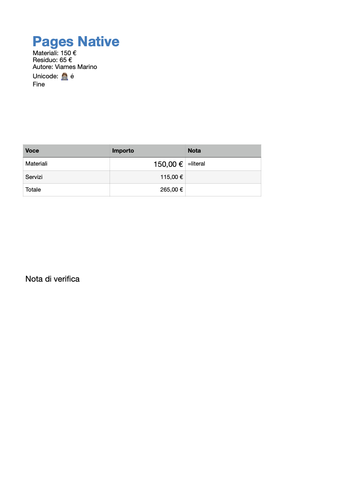

# Pages Native

[](https://mcpservers.org/servers/viames/pages-native)

Native Apple Pages documents for Codex and MCP. **Author: Viames Marino · MIT.**

**Version 0.5.0.** Native acceptance passed 76 checks on one Mac with Pages 14.5 and macOS 27.0.1; 70 portable tests passed separately. Other Pages/macOS configurations remain unverified. See [verification](docs/VERIFICATION.md).

Pages Native uses Apple's scripting API through fixed JXA and AppleScript workers. Documents remain `.pages`: no Word conversion, private-format parser, clipboard driver, Accessibility or UI automation.

## Capabilities

36 MCP tools cover native documents and templates, rich text, existing tagged placeholders, tables with formulas, text/shape/image objects, existing object geometry, explicit native exports, opaque backups and PDF/PNG previews. Existing-text edits, placeholder fills, text/cell formatting, table/cell changes, sorting, merging, dimensions, objects and facing-page changes have preview/apply revision guards. **Migration from 0.1:** mutation tools now default to preview. Apply the identical request with `mode:"apply"` and its `expected_revision`; a successful preview is not a completed edit.

New in 0.5: previewed batches of up to 10 native outputs, immutable recipe history with saved prototype snapshots, structural comparisons, historical reuse and guarded restoration. [Batch and history guide](docs/BATCH-AND-HISTORY.md).

New in 0.4: typed table fields in composed models and a local reusable recipe library with relative prototype paths, saved-byte fingerprints, version counters and guarded save/delete/use. See [typed fields and recipes](docs/RECIPES.md).

New in 0.3: structured literal search with native text/cell references, and guided composition from saved prototypes with required/default fields and revision-guarded new copies. See [search and model recipes](docs/SEARCH-AND-TEMPLATES.md).

Mutations may partially apply; there is no automatic rollback. Pages 14.5 exposes placeholder tags for reading but rejects changing them through its scripting API.



The synthetic example shows a native table total of 265 EUR and a separately positioned text item.

The native API does not expose complete paragraph styles, headings/lists, comments, tracked changes, hyperlinks, headers/footers, page setup or chart series/type/title. Features already present in a saved prototype can be preserved through opaque native copies. Creating and editing chart data is not claimed. Font/size/color formatting does not assign named paragraph styles; semantic style preservation during model filling is not yet certified.

## Requirements and installation

- macOS with an interactive, logged-in session and Apple Pages.
- Node.js 22 or later and Automation permission for the actual host controlling Pages.
- Local execution. This cannot run against the user's Mac from a cloud-only task.

Install the public Codex plugin marketplace and enable Pages Native:

```sh
codex plugin marketplace add viames/pages-native
codex plugin add pages-native@viames-pages
```

Start a new local Codex task and run the setup skill. A compatible MCP host can run `node /absolute/path/to/plugins/pages-native/dist/server.mjs`; runtime npm installation is unnecessary after build.

Optional `PAGES_NATIVE_ALLOWED_ROOTS` is a JSON array of existing directories. It guards plugin file paths; it is not a macOS sandbox for the Pages process.

## Development

```sh
npm ci
npm test
npm run build
npm run test:bundle
npm run test:native
npm run package
```

Portable tests validate protocol, bounds, path restrictions, revision planning and timeout recovery. `test:native` controls Pages on an explicitly designated Mac using isolated synthetic documents; ordinary CI does not certify a graphical Pages installation.

See [compatibility reports](docs/COMPATIBILITY.md), [capabilities](docs/CAPABILITIES.md), [verification](docs/VERIFICATION.md), [publishing](docs/PUBLISHING.md) and [privacy](docs/PRIVACY.md).
