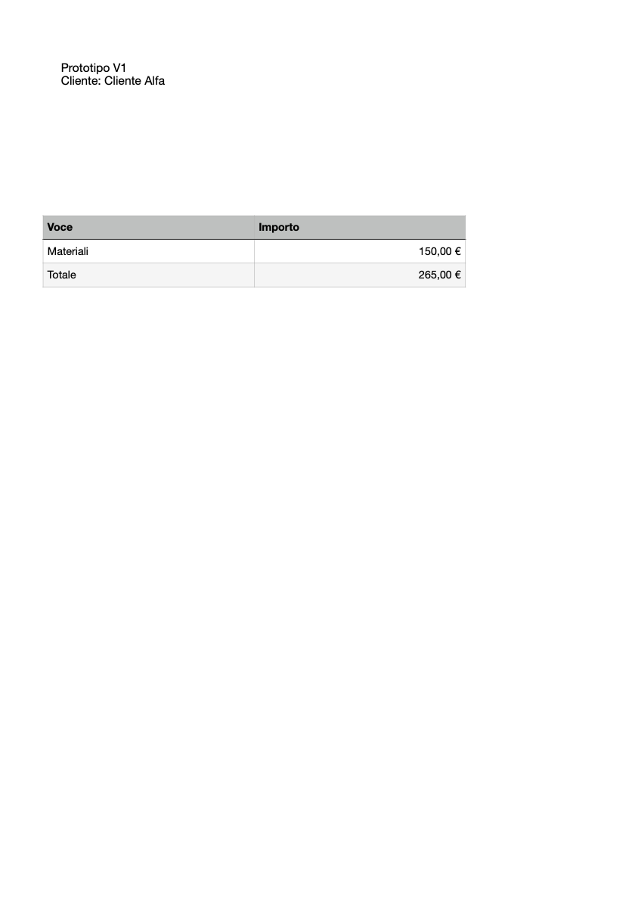

# Batch generation and recipe history

Pages Native 0.5 adds `pages_compose_batch` and `pages_recipe_history`. Document operations use only the public Pages scripting API. History stores ordinary local JSON and opaque saved `.pages` copies; it never parses the private native format.

## Preview a whole batch

Save a recipe using the [recipe guide](RECIPES.md), then call `pages_compose_batch`:

```json
{
  "library_path":"/absolute/project/Recipes",
  "name":"scheda-cliente",
  "version":1,
  "items":[
    {"id":"cliente-a","path":"/absolute/project/Outputs/A.pages","values":[{"name":"cliente","value":"Cliente A"},{"name":"materiali","value":150}]},
    {"id":"cliente-b","path":"/absolute/project/Outputs/B.pages","values":[{"name":"cliente","value":"Cliente B"},{"name":"materiali","value":0}]}
  ],
  "on_error":"stop",
  "close_outputs":true
}
```

`version` selects an archived recipe and its saved model; omit it to use the current definition. Every item has a unique ID and a distinct new `.pages` destination. All records undergo native preflight before any destination is created. Review each planned field/change, then repeat the identical arguments with `mode:"apply"` and `expected_revision` from the preview. Changing items, values, options, the selected recipe or model invalidates the preview. An unchanged historical revision remains usable after the current recipe changes.

A batch contains 1–10 documents and runs sequentially under the cooperative native lock. Outputs are not transactional. Each result is `completed`, `failed` or `not_attempted`; inspect counts and every failure. The default stops on the first failure. Explicit `on_error:"continue"` attempts remaining records after ordinary errors, but uncertain native state or a timeout always stops the batch. A failed native mutation is never retried automatically, and its partial output remains available for inspection.

`close_outputs:true` closes only newly created successful outputs that are still saved and unmodified. A user-modified output stays open; inspect `close_state` and any `close_error`. Sources and unrelated documents are not closed. Set false when the user wants successful outputs left open. Export selected generated documents afterwards using the existing explicit native export tools; batch export is not implicit.

## List, read and compare history

`pages_recipe_history` takes `library_path` and `name`. With neither version argument it lists committed saves, restores, imports and deletion events, including timestamps and prototype availability. Add `version` to read a definition; add `compare_version` to compare its description, prototype fingerprint and field definitions/defaults. Comparison is structural, not a visual document diff.

Starting with 0.5, each applied save stores the definition plus a verified opaque copy of the saved model, deduplicated by content fingerprint. Delete removes the current recipe JSON while retaining history. Version numbers increase across deletion and recreation; old revisions are never overwritten. Last-use recipient values and generated document contents are not saved in the library. Explicit field defaults remain part of the archived definition.

To restore an archived revision, preview `pages_recipe` with `operation:"restore"`, `version`, library and name, then apply the identical request with its revision. Restoration creates a NEW current version pointing to the archived model; it never overwrites the original prototype or erases later history. Deletion events themselves cannot be restored or composed. `pages_compose_recipe` also accepts `version` for a single historical output.

## Migration, portability and limits

Move or back up the WHOLE library, including hidden `.pages-native-history`. Current definitions normally still reference their original model relatively; move those models with them or use an explicit identical-source override. Historical composition uses the archived copies. Restored definitions reference those copies within the library.

On the first mutation of a pre-0.5 recipe, its available current definition is imported. If the old prototype is missing or its bytes already changed, that old definition is retained with `prototype_available:false`; composing/restoring it reports `HISTORY_SOURCE_UNAVAILABLE`. Previously overwritten or deleted pre-0.5 versions cannot be recovered. No history is invented retrospectively.

There are at most 1,000 archived entries per recipe; the plugin does not purge them automatically. Archived sources consume disk space and identical sources are reused. Hash checks detect changes before historical reuse. This is a local library with ordinary filesystem permissions, not an authenticated or tamper-proof audit service. Use normal backups for disaster recovery.

A per-library lock serializes mutation. An atomic history pointer identifies completed commits; interruption may leave an uncommitted candidate, reported in `uncommitted_versions`. Such a candidate cannot be used for composition/restoration. A mismatch between the current definition and committed history produces `HISTORY_CONFLICT`; inspect and recover the library deliberately. Older plugin versions must not edit a managed 0.5 library. No automatic deletion, lock removal or rollback of native document edits is performed.

## Native acceptance example

A document generated from historical model V1 after the original changed to V2, with typed currency and a calculated total of 265.


