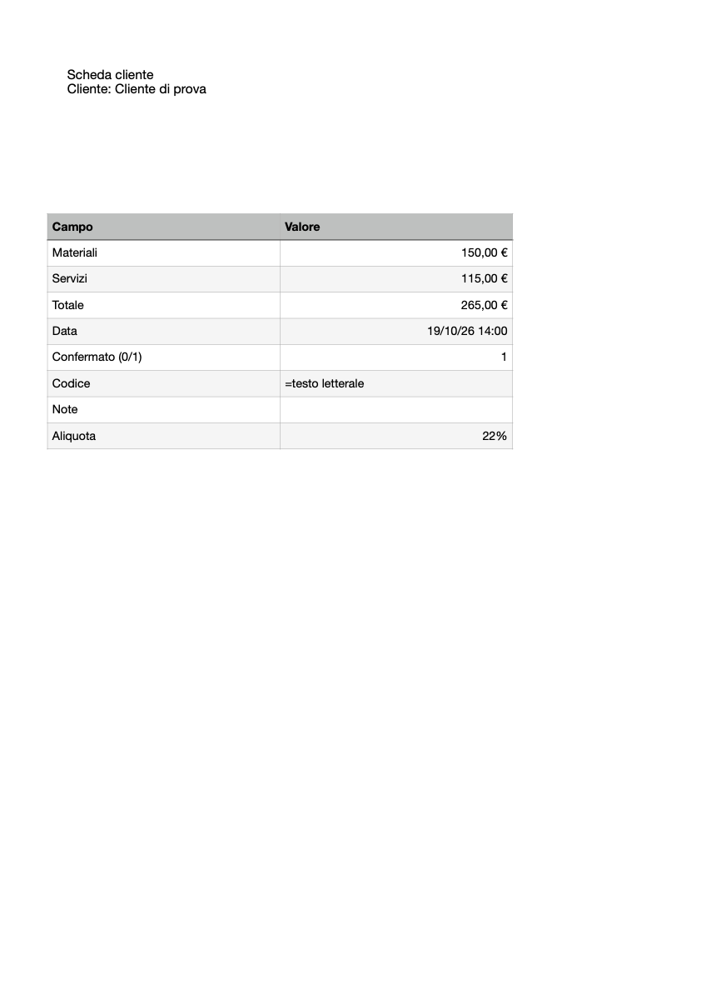

# Typed table fields and a reusable recipe library

Pages Native 0.4 adds native cell bindings to `pages_compose`, plus `pages_recipes`, `pages_recipe` and `pages_compose_recipe`. Document editing still happens exclusively through public Pages scripting, with a new opaque `.pages` copy for each output. Recipe JSON is local ordinary configuration; it never parses or rewrites the private Pages format.

## Cell bindings

First inspect a saved prototype with `pages_inspect` and `pages_read_cells`. Every cell binding requires the document-wide 1-based table index, its exact native name, and one A1 cell address. The existing table must already have the needed dimensions. Cells are not created or resized implicitly.

```json
[
  {"name":"cliente","value":"Cliente di prova","bindings":[{"kind":"text","find":"{{cliente}}"}]},
  {"name":"materiali","value":150,"bindings":[{"kind":"cell","table":1,"table_name":"Dati","address":"B2"}]},
  {"name":"servizi","default":115,"bindings":[{"kind":"cell","table":1,"table_name":"Dati","address":"B3"}]},
  {"name":"totale","default":{"formula":"=SUM(B2:B3)"},"bindings":[{"kind":"cell","table":1,"table_name":"Dati","address":"B4"}]},
  {"name":"data","value":{"date":"2026-10-19T12:00:00Z"},"bindings":[{"kind":"cell","table":1,"table_name":"Dati","address":"B5"}]},
  {"name":"confermato","default":0,"bindings":[{"kind":"cell","table":1,"table_name":"Dati","address":"B6"}]},
  {"name":"note","required":false,"value":null,"bindings":[{"kind":"cell","table":1,"table_name":"Dati","address":"B8"}]}
]
```

Pass those fields with `source_path` and a new `path` to `pages_compose`, review its preview and apply the identical request with `expected_revision`. Cell previews include exposed values/formulas/styles and exact native base formats. Duplicate cell bindings and wrong table names are rejected before copying. Locked native tables must be unlocked deliberately through the existing guarded table tool.

Values retain explicit types:

| Value | Native meaning |
| --- | --- |
| String, including `"=SUM(...)"` | Literal text, never an implicit formula. At most 10,000 characters per cell. |
| Number, including `0` | Numeric value; compatible existing currency/percent/etc. base format is preserved by default. |
| Boolean, including `false` | Rejected before writing: Pages coerces these to numeric 0/1; checkbox controls are Numbers-only. Supply a deliberate number or text instead. |
| `{"date":"ISO timestamp with timezone"}` | Native date/time. |
| `{"formula":"=..."}` | Explicit native formula; Pages may return localized function names. |
| `null` with `required:false` | Deliberately clear the cell. |

Required fields accept numeric zero; they reject missing values, null and whitespace-only strings. Optional missing fields are skipped. `default` is used only when `value` is absent; an explicit optional null does not fall back to a default. Text and placeholder bindings require strings; no implicit date/number formatting is applied to prose. Use separate display fields where necessary.

`preserve_format` defaults to true and preserves compatible **base** formats. Strings deliberately use Text and dates Date and Time. The plugin rejects boolean cell values and the checkbox format rather than silently converting them. This does not certify all custom format details that Pages does not expose. Readback checks literal/numeric/date values, formula presence and compatible base formats. Formula expressions are not translated or symbolically proven equivalent; inspect returned native formulas and verify expected calculated values.

Cell bindings can accompany either literal text fields or native script-tag fields. Literal text and script-tag modes still cannot be mixed with each other in one recipe. One field can bind multiple cells, but each cell may be mapped only once. Existing scope limits remain: 100 fields, 100 native text targets, 100,000 native text characters and 200 replacements including cells. Unexposed merge topology cannot be guarded.

A source fingerprint and full preflight protect the preview and opened copy. Before each cell write, native guards recheck the target's identity, original input/formula/styles and base format. Calculated results of an existing formula may change after earlier field writes; this is allowed while its formula and styles stay unchanged. Own text edits may reflow table geometry. The immediate native write precondition still checks the current exposed state. Native operations are not transactional: inspect any `COMPOSITION_INCOMPLETE` destination rather than retrying automatically.

## Local library

Choose an absolute `library_path`, normally a `Recipes` folder beside your project's models. Its parent must already exist. `pages_recipe` creates the library only when saving is applied. Listing a missing library returns an empty result with `exists:false`. Library operations do not launch or control Pages.

- `pages_recipes`: list metadata, or pass `name` to read a stored definition and revision. Invalid entries are reported individually; they are not silently used.
- `pages_recipe`: preview/apply `operation:"save"`, `operation:"delete"` or `operation:"restore"` for one named recipe.
- `pages_compose_recipe`: supply the library, recipe name, new output path and current field values. Defaults and bindings come from the stored definition. Add `version` to compose an archived definition and prototype.

Names use lowercase ASCII letters/digits, hyphens and underscores, up to 64 characters, beginning with a letter or digit. A library contains up to 1,000 named recipes; each JSON file is at most 1 MiB. Symlink/special recipe entries are rejected. Files are written atomically, with a cooperative per-library mutation lock. A stale lock is not removed automatically; verify that no writer is active before recovering it.

### Save definitions

Call `pages_recipe` with:

```json
{
  "library_path":"/absolute/project/Recipes",
  "name":"scheda-cliente",
  "operation":"save",
  "recipe":{
    "source_path":"/absolute/project/Models/Scheda.pages",
    "description":"Scheda con tabella nativa",
    "fields":[
      {"name":"cliente","bindings":[{"kind":"text","find":"{{cliente}}"}]},
      {"name":"materiali","bindings":[{"kind":"cell","table":1,"table_name":"Dati","address":"B2"}]},
      {"name":"servizi","default":115,"bindings":[{"kind":"cell","table":1,"table_name":"Dati","address":"B3"}]}
    ]
  }
}
```

Review `before`/`after`, then repeat the identical request with `mode:"apply"` and its preview revision. Stored fields accept definitions and explicit defaults, **not `value`**. Recipients and values supplied to later compositions are not written back to the library.

The stored file includes `schema_version:1`, name, an incrementing integer recipe `version`, description, fields, a source path relative to the library and the saved prototype's SHA-256 fingerprint. Updating a definition increments its version, and the old revision cannot overwrite it. Starting with 0.5, applied changes archive definitions and verified opaque saved prototypes. Deleting removes only the current named JSON and retains history; restoration creates a new version. See [batch generation and history](BATCH-AND-HISTORY.md), including the limits of importing pre-0.5 recipes.

### Reuse and move

```json
{
  "library_path":"/absolute/project/Recipes",
  "name":"scheda-cliente",
  "path":"/absolute/project/Outputs/Cliente.pages",
  "values":[
    {"name":"cliente","value":"Cliente di prova"},
    {"name":"materiali","value":150}
  ]
}
```

Preview `pages_compose_recipe`, then apply identical arguments with its returned revision. Unknown or duplicate field names are rejected. The preview binds the stored recipe revision as well as field values, prototype state and output path. A recipe change invalidates the old preview, including a description-only update.

Move the library and models together preserving their relative arrangement. Alternatively pass `source_path` to `pages_compose_recipe` to relocate an identical prototype explicitly. Allowed-root restrictions still apply. If the prototype bytes change, including a Pages save that changes its native bytes, `RECIPE_SOURCE_CHANGED` requires reviewing and saving a new recipe revision deliberately. Neither a path override nor a preview bypasses the source fingerprint.

Recipes and prototypes are never uploaded or published by these tools. Every successful composition saves a distinct `.pages` output and returns its new native ID, resolved field outcomes, native cell readbacks, source-preservation result and recipe version/revision.

## Native acceptance example

This synthetic model was filled through the native API: compatible currency and percent formats, a calculated total, an ISO date displayed in the local timezone, a deliberately numeric 0/1 flag, literal formula-like text and an optional cleared cell.


