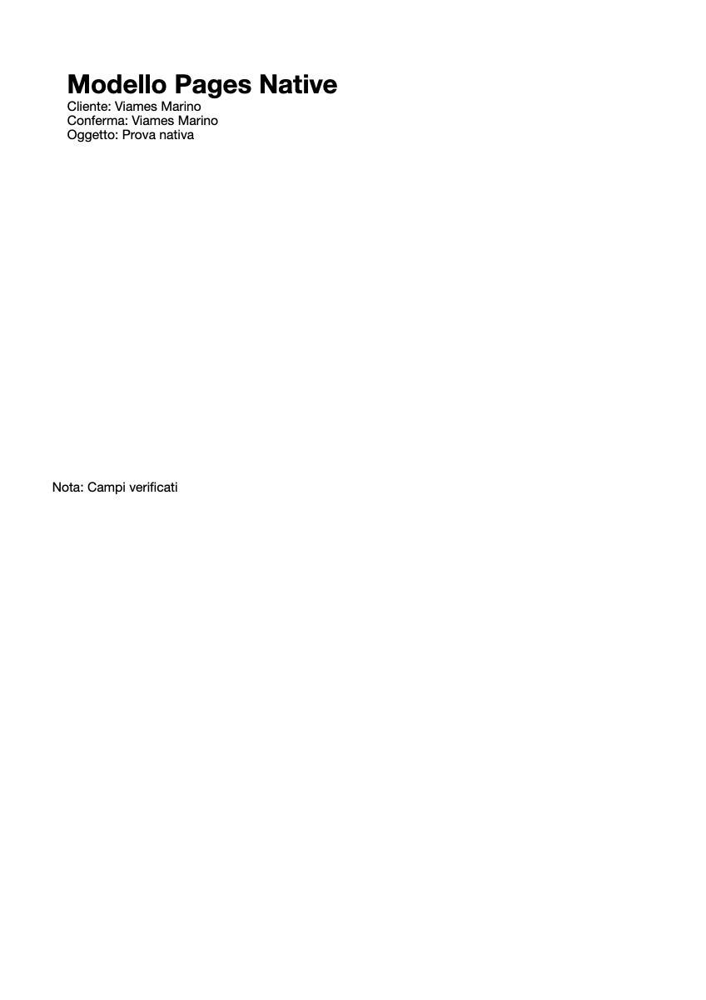

# Structured search and guided composition

Both workflows use public native Pages scripting. No document is converted or privately parsed. File paths below are examples: choose existing absolute source paths and new absolute destinations on your Mac.

## Search

`pages_search` takes an explicit `document_id` and literal `query`. Its default scopes are `body`, `text`, `shape` and `table`. A page-layout document simply has no default body target. Optional `section` and `page` scopes read native text at those levels; they can duplicate body results, so scope overlap is not deduplicated. Only document collections exposed by Pages are searched; this is not a complete index of hidden/grouped contents, headers or footers.

Text hits include `target`, 1-based native `start`, `delete_count`, matching text, surrounding context and a text snapshot revision. These positions follow Pages' returned character list, including compound Unicode characters. A substring that would split a native character is excluded and counted. Use `pages_edit_text` preview/apply for an actual edit: the search revision is informational and is **not** an edit approval revision.

Table hits include the document-wide table index, name, cell address and `channel`. The normal channel is the displayed/formatted value; set `include_formulas:true` to search formula text separately. Formula text is exactly what Pages returns, including localized function names such as `SOMMA`; use `pages_read_cells` to inspect it rather than assuming English names. Formula and displayed-value hits can refer to the same cell. Table hits do not provide native rich-text editing ranges.

Useful options:

- `case_sensitive:false` uses JavaScript Unicode case-insensitive literal comparison, not locale-specific accent folding or linguistic stemming. The query is never interpreted as a regular expression.
- `text_targets:[{"kind":"section","index":1}]` restricts text reads. Each target kind must belong to `scopes`. An explicit body target on a page-layout document is an error.
- `table_ranges:[{"table":1,"range":"A1:C20"}]` restricts table reads; include the `table` scope. Overlapping ranges can return duplicate cells.
- `max_results` defaults to 50 and caps at 200. `offset`/`next_offset` paginate a fresh full bounded scan; they do not hold an immutable snapshot across calls. Inspect `total_matches` and re-preview edits after any document change.

Each call supports at most 100 native text targets, 100 table ranges, 2,000 total cells and 100,000 combined text characters. An excessive scope fails instead of returning an allegedly complete partial search. Native text uses native-character counts; table display/formula budgets use JavaScript string units. Restrict the scopes/targets/ranges for large documents. The cooperative lock prevents other Pages Native calls from interleaving, but does not freeze manual editing or unrelated automation.

## Guided model recipes

`pages_compose` receives a saved `.pages` `source_path`, a **new** destination `path` and a reusable JSON `fields` array. A recipe can be kept in your project and passed to the tool with different values. It deliberately fills only declared bindings; it does not infer fields from arbitrary prose.

Example fields for a custom prototype containing literal tokens:

```json
[
  {
    "name": "cliente",
    "value": "Viames Marino",
    "bindings": [{"kind": "text", "find": "{{cliente}}", "expected_count": 2}]
  },
  {
    "name": "oggetto",
    "default": "Relazione di prova",
    "bindings": [{"kind": "text", "find": "{{oggetto}}"}]
  },
  {
    "name": "nota",
    "required": false,
    "bindings": [{"kind": "text", "target": {"kind": "text", "index": 1}, "find": "{{nota}}"}]
  }
]
```

For typed native table fields and saved recipe libraries, see [typed cells and reusable libraries](RECIPES.md). The text-only examples below remain valid.

Fields are required by default. A missing or whitespace-only required value is rejected. `value` takes precedence over `default`. An optional field with neither is skipped and its source content remains unchanged. An explicitly empty optional value deliberately removes its bound text. Field names must be unique. Each binding declares its exact total `expected_count`, default 1; all matching occurrences are replaced with the same field value. Replacement values are literal and are not recursively interpreted as template instructions.

For a saved prototype with native script-tagged placeholders, first inspect `pages_placeholders`, then use bindings such as:

```json
{"name":"titolo","value":"Relazione annuale","bindings":[{"kind":"placeholder","tag":"EXACT_NATIVE_TAG","expected_count":1}]}
```

Use either literal text bindings or native placeholder bindings in a single recipe. Either mode can also include typed cell bindings. Mixing them is rejected because their native ranges can overlap. Literal bindings can cover one body/section/page scope plus separate text items and shapes; using multiple body/section/page targets in a recipe is rejected conservatively. Overlapping literal replacements or duplicate placeholder bindings are rejected before creating a destination. Composition supports at most 100 fields, 100 distinct text targets, 100,000 native text characters and 200 replacements. Individual fields have at most 20 bindings.

### Preview and apply

1. Save the prototype deliberately. Unsaved open changes are rejected. A preview may briefly open a closed source to read it through Pages; it creates no destination, changes no text and never saves the source. If another actor modifies the temporarily opened source, it remains open rather than discarding those edits.
2. Call `pages_compose` with the paths and fields. Review resolved values, skipped fields, occurrence counts, target before/after text and placeholder replacements.
3. Submit the **identical** paths and fields with `mode:"apply"` and the returned `expected_revision`. Changes to source bytes, native field state, values, bindings or destination path invalidate the preview.
4. The tool verifies an opaque copy, opens that copy, validates its plan again, fills it through guarded native text/placeholder operations and saves it. The result includes the new document ID, completed/skipped fields, replacement count and any native placeholders still present. Existing insertion formatting is inherited; use a native PDF/PNG preview to check layout.

No overwrites, source saves or automatic rollback are provided. A `COMPOSITION_INCOMPLETE` error identifies the destination, its ID when known, the underlying error and fully completed target groups. An error within a target can leave partial replacements even when that group is absent from the completed list. Inspect the copy before deciding what to do; never automatically retry. Native guards cover API-visible text, not all editorial properties. Saved source bytes are fingerprinted to preserve the rest of the designed template opaquely.

## Native acceptance example

The synthetic composed document below was generated through the native API. Repeated client fields, a default subject and a separate text item were filled while the heading retained its native formatting.


